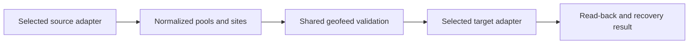

# Input and output adapters

Choose an input with `source.type`. Choose an output with `publish.type`.
Both choices are required for publication. No Sonar account or WordPress site is required when using other adapters.

## Input contract

`Source.snapshot()` reads inventory without changing the platform. It returns a mapping with
`pools` and `sites`. Each pool has a stable ID, exact `ip_range`, containing `subnet`, and
an optional `site_id`. A site has a stable ID and structured country, region and city values
in `addresses`. Preserve the evidence for a missing or conflicting link in `scope_error`.

`Source.for_publication(snapshot)` selects the intended records. Discovery may include more
records than publication. It must fail if selection is empty or invalid. Stable source IDs
let the core apply explicit mappings and exclusions without guessing names.

Register a trusted factory in `adapters.SOURCES`, with its allowed settings and honest
`initial` flag. Source-specific credentials are read only by that factory. Optional discovery
methods may expose extra evidence. They must not change publication policy.

The model can come from billing, IPAM, network management or a reviewed export.
An API that provides subscriber addresses alone does not prove where a hosting pool belongs.
Joining several input systems is future work. A join must use reviewed stable IDs and report
conflicts. The current CLI selects one source per run.
[Issue #38](https://github.com/MHammett/isp-geofeed-generator/issues/38) tracks combining
inventories, including Sonar customer subnets with NetBox infrastructure subnets, followed
by a separate mode for explicit site/location enrichment.

## Output contract

`Target.publish(payload, state_dir, **guards)` accepts validated UTF-8 CSV bytes or a list
of normalized `{prefix, location}` records, according to its `payload_format` metadata.
Targets declare supported `location_fields` and `required_fields`. The core checks these
before calling the target. See [output formats](output-formats.md) for the field contract.
It returns a result only after checking the written bytes. File, WordPress and rich JSON
are independent targets. Other transports can supply their own serializers.

Every new target must enforce the shared change guard, protect against competing writes,
keep the prior feed for recovery and distinguish an unverified recovery from success.
File read-back proves local bytes only. A web server or object-store adapter must also
verify the actual public URL. An upload acknowledgement alone is insufficient.

## Tests for an adapter

- Use fixtures based on a documented version. Do not commit live customer data.
- Prove authentication failure, incomplete paging, duplicate records and missing site links stop publication.
- Test exact IPv4 and IPv6 boundaries, selected records and conflicting site evidence.
- For a target, force stale state, lost write replies, bad public read-back and failed recovery.
- Confirm unrelated adapters' credentials are never requested.
- Run a live read-only check when access exists. Keep that result separate from fixture tests.

The built-in registries load code shipped with the project. Separately installed, trusted
extensions use [versioned entry points](customization.md) and must be explicitly enabled.
Configuration cannot import module paths, invoke shell commands or install plugins.
Adapter selection does not grant write access to a source platform.

The CLI checks [current fullbogons](bogons.md) before any output adapter receives a payload.
Low-level SDK publishers do not download allocation data on their own.
The CLI owns the publication lock and status file. Discovery and candidate generation do
not take that lock or overwrite publication health. Use separate candidate output files;
do not point `--output` at the published feed or its recovery files.
